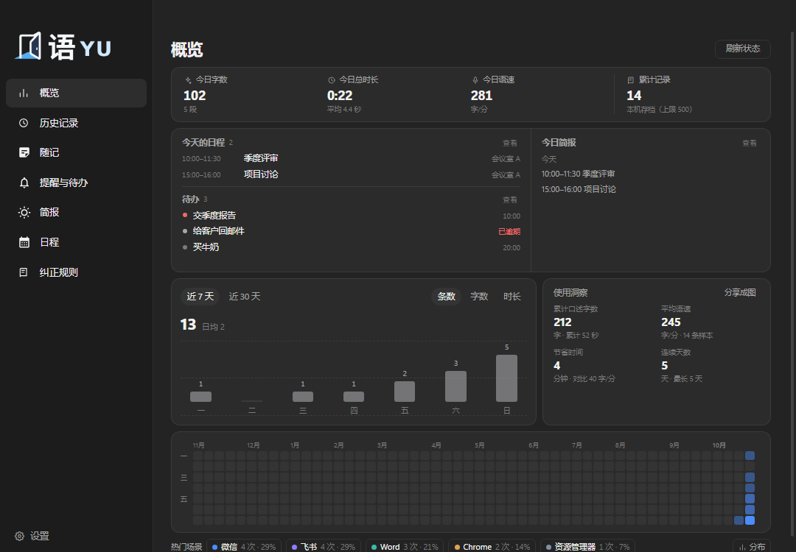
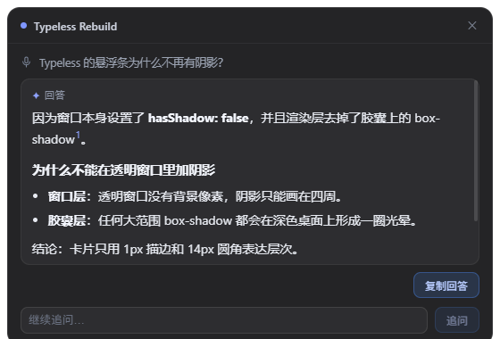
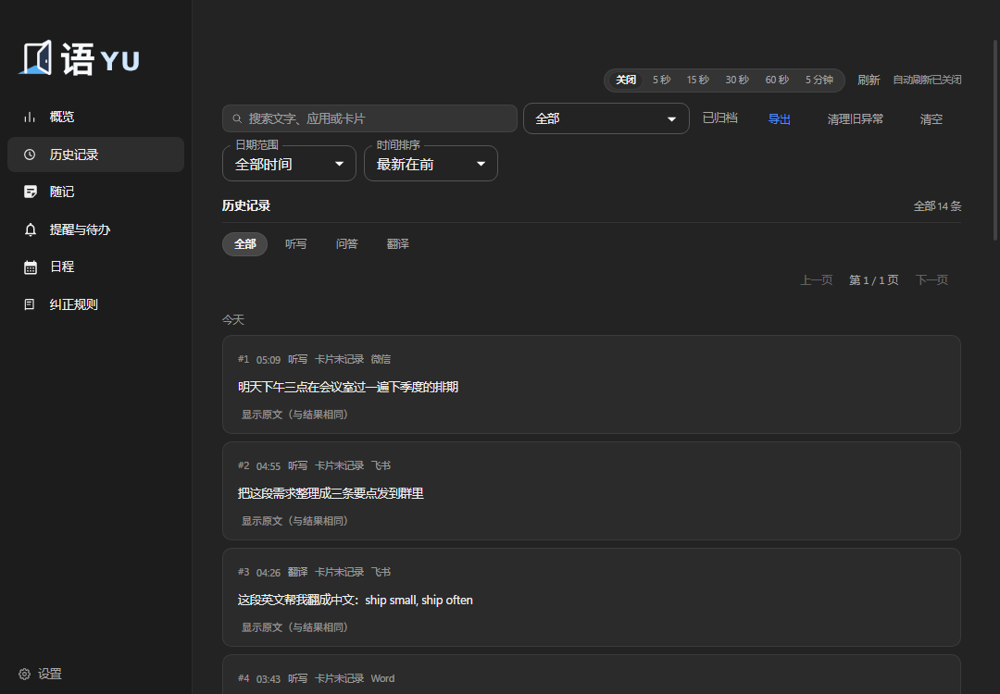
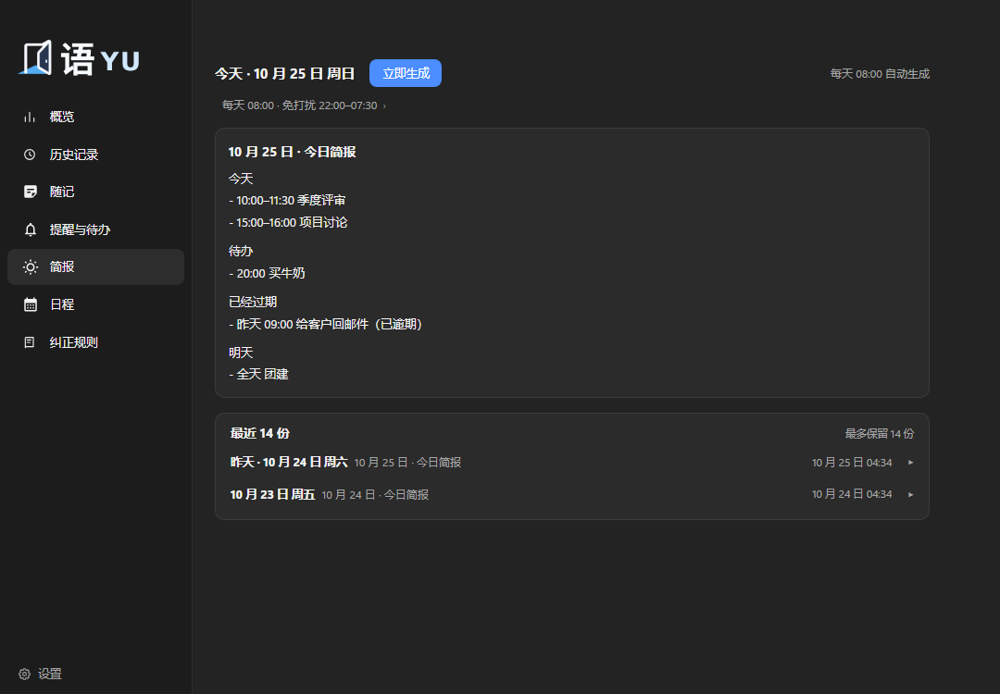
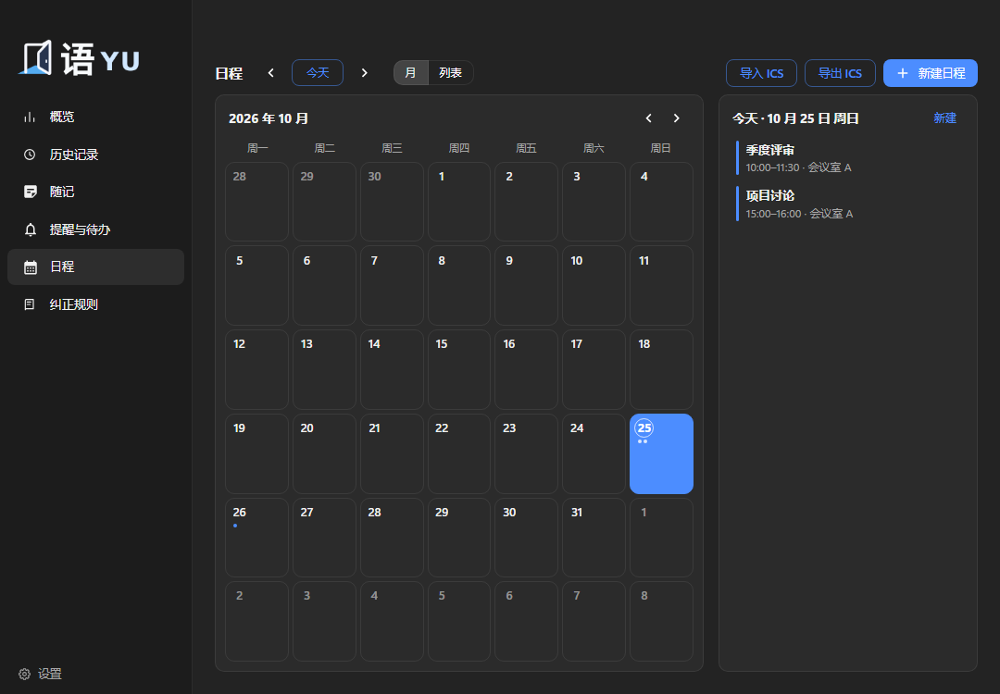
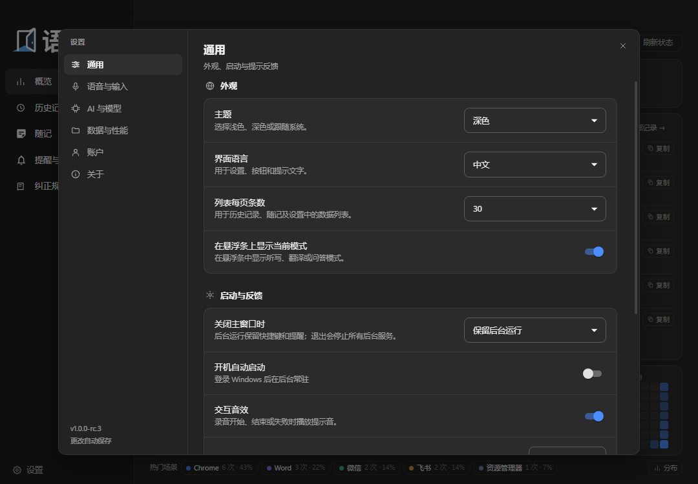
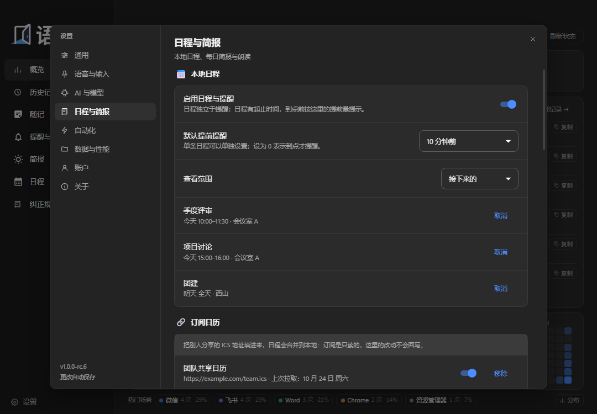
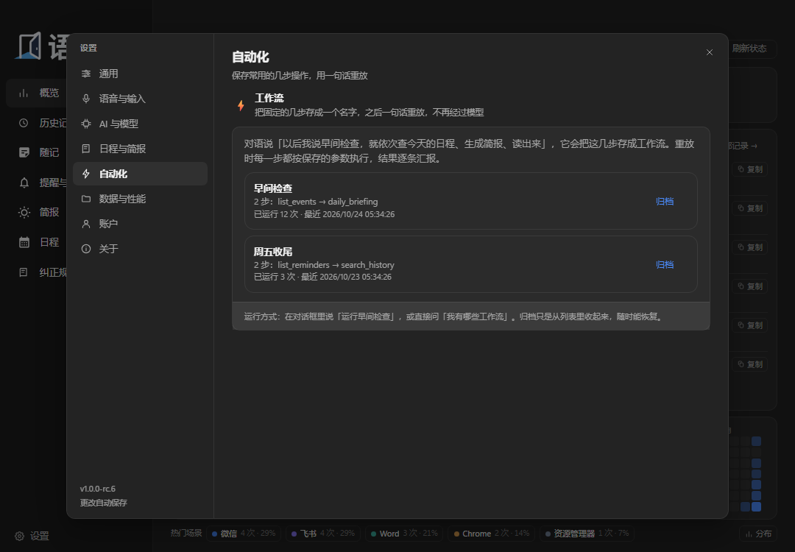
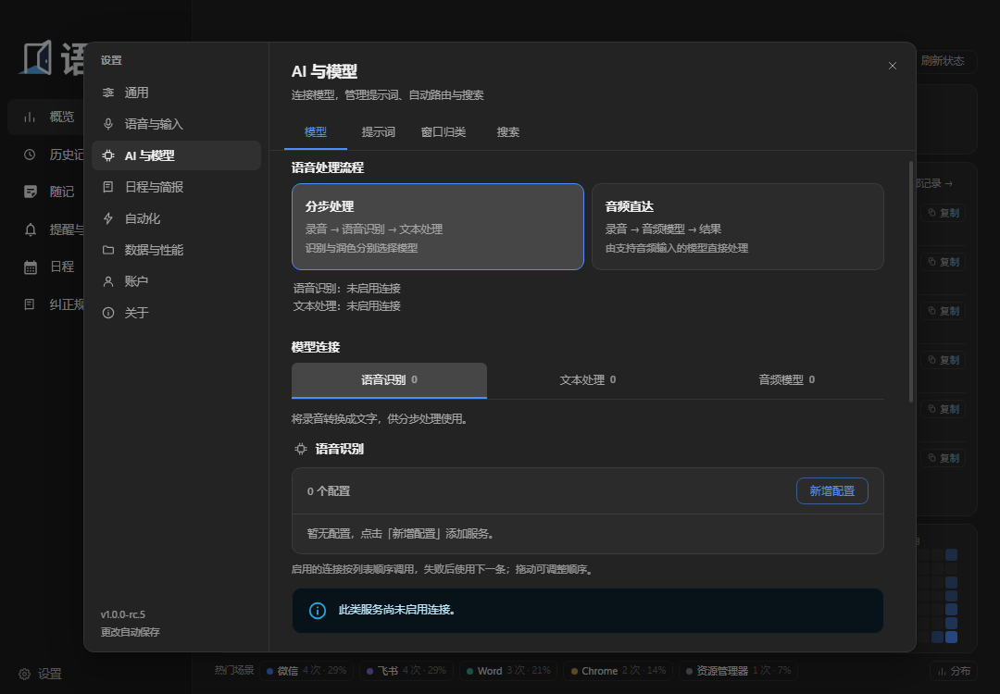

# YU / 语

**Use your own words to work with your computer.**

A Windows voice input and local AI assistant: press a hotkey, speak, and the cleaned-up text is typed into whatever field is focused. The same hotkey also translates, answers questions, files notes, creates reminders and captures screen regions. Every model and search backend is yours to configure — or keep it entirely on your own machine.

[中文](README.md) · [Design philosophy (Chinese)](resources/brand/PHILOSOPHY.zh-CN.md) · [Roadmap](ASSISTANT_ROADMAP.md) · [Server deployment](server/README.md)

> Current version **1.0.0-rc.10**, Windows 10/11 x64, MIT.
> This is a release candidate: finished features work, unfinished ones are listed item by item in the [roadmap](ASSISTANT_ROADMAP.md).


## What it does

| Capability | In one line |
| --- | --- |
| **Dictation** | Press to talk, press again to stop; the result is inserted at the caret — clipboard paste first, SendInput character injection as fallback, then read back to verify |
| **Ask** | `Space + Right Alt` to start, retrieval plus a tool-calling agent, the answer lands in a floating card you can pin, follow up on, or save as a note; it can also read local file bodies (plain text, docx, xlsx, pptx) and the Everything index |
| **Translation** | A dedicated translation mode and a selection-translation hotkey; 1–3 target languages, source language left to the ASR |
| **Notes** | Voice or typed notes with categories and tags, playback, and audio import with re-transcription; polished text and raw transcript are kept separately |
| **Reminders / to-dos** | Natural-language times (Chrono plus programmatic checks), repeats, snooze, a strong-alert overlay, missed-item recovery; each to-do can carry a priority and a deadline |
| **Events** | Its own page: month grid, day list, create and edit (start, end, location, advance alert), ICS import and export — the page and the assistant write the same data; subscribe to external ICS calendars (including Google / Outlook secret addresses) and sync both ways once you sign in to your own server |
| **Briefing / read-aloud** | Its own page plus a daily schedule: today's events, due to-dos, overdue items and tomorrow's preview, optionally written as one paragraph by a model (falling back to the template), readable aloud; quiet hours hold delivery back, and the last two weeks stay on this machine |
| **Automation** | Save a sequence of steps you repeat as a named workflow and replay it with one sentence, with no model in the loop; each step runs with the saved arguments and reports its result |
| **Screen capture** | Region or window snapping, eight-handle resize, rectangle / ellipse / arrow / pen / text / mosaic tools, Windows OCR and smart translation |
| **Wake word** | Optional offline wake word using Windows on-device speech, with a selectable input device; nothing is uploaded or stored before it fires |
| **Updates** | Checks this project's GitHub Releases by default; when a newer build exists the hub shows a pill at the bottom left, and one click downloads and restarts into it |
| **Sync** | Optional self-hosted server for history, notes, note audio, events, reminders and per-device personal stats; dictation audio stays on the machine that recorded it |

## Screens



| The bar while recording | Ask answer card |
| --- | --- |
|  |  |

| History | Briefing |
| --- | --- |
|  |  |

| Events | Settings (general) |
| --- | --- |
|  |  |

| Settings (schedule & briefing) | Settings (automation) |
| --- | --- |
|  |  |



A fresh install has no working connections: this is where you add a recognition and a text connection — address, key, model — test it, then save. Records shown in these screenshots are demo content.


Events carry a start, an end, a location and an advance alert, and can be imported from or exported to ICS. The daily briefing folds today's events, due to-dos, overdue items and tomorrow's preview into one paragraph you can have read aloud, and quiet hours hold it back. Events have their own page under Reminders in the main window, and the calendar and its data stay on this machine.

The automation page lists the workflows you saved: describe a run of steps once, then replay it with a single sentence — no model in the loop, each step reported as it finishes.

## Quick start

Requirements: Windows 10/11 x64, Node.js 22.18 or newer (the self-hosted server needs ≥ 22.5 because it uses `node:sqlite`), and pnpm 11.

```powershell
git clone https://github.com/sqslm/YU.git
cd YU
pnpm install --frozen-lockfile

# Optional: a local fake backend, so you can try things without any API key
pnpm mock                     # http://127.0.0.1:8787/v1

pnpm build
Remove-Item Env:ELECTRON_RUN_AS_NODE -ErrorAction SilentlyContinue   # see Known pitfalls
node_modules\electron\dist\electron.exe .
```

For development use `pnpm dev`. A fresh install has no model connections: open **Settings → AI & models**, add an ASR connection and a text connection, fill in address, key and model, test it, save. With the fake backend, point the address at `http://127.0.0.1:8787/v1` (starting the mock does not change your settings).

Building the installer:

```powershell
$env:ELECTRON_MIRROR='https://npmmirror.com/mirrors/electron/'
$env:ELECTRON_BUILDER_BINARIES_MIRROR='https://npmmirror.com/mirrors/electron-builder-binaries/'
pnpm package          # -> release\YU-<version>-setup.exe (unsigned)
```

## Usage

| Action | Default shortcut |
| --- | --- |
| Dictation (recognize + polish + insert) | `Right Alt` — press once to start, once to stop |
| Ask (optional web retrieval before answering) | `Space + Right Alt` to start, a **single `Right Alt`** to finish |
| Translation mode | `Right Alt + Right Shift` |
| Paste the last result | `Left Ctrl + Right Shift + V` |
| Polish selection / translate selection | `Left Ctrl + Right Shift + S` / `T` |
| Quick voice reminder | `Left Ctrl + Right Shift + R` |
| Region capture / OCR / smart translate | `Left Ctrl + Right Shift + X` |
| Settings / new note | `Ctrl + ,` / `Ctrl + N` (notes page only) |

Three things worth knowing:

- **Trigger mode** can be switched in the Shortcuts page between "press to start, press to stop" (default) and "hold to talk". In press mode, dictation, Ask and voice translation all end with another single `Right Alt`.
- **Press `Esc` while recording** to throw the take away: it is neither inserted nor written to history.
- Every shortcut can be re-recorded or cleared, and the tray menu can suspend all of them temporarily. Recording a shortcut distinguishes left and right Shift / Ctrl / Alt.
- **Say it, and it is noted**: in Ask, “schedule a project review tomorrow 3 to 4 pm” creates an event, “what is on today” lists events, “read today’s briefing” speaks it, and “mark that to-do high priority, due Friday” updates it. These are all allowlisted tools — answers come from real data, and an empty result stays empty.
- **Follow-ups do not need the context repeated**: "make the second one eleven", "mark the last one high priority" — the assistant resolves the target against the previous turn's real results, and asks first when it cannot tell which item you mean instead of guessing.
- **Say it once, replay it with one sentence**: tell it “from now on, when I say morning check, look at today's calendar, build the briefing and read it out” and it saves those steps as a workflow. Saying “run morning check” then runs each step with the saved arguments, with no model in the loop, and lists what every step returned. Workflows can be archived or restored in settings under Automation.

## Configuration

- **Models**: choose "staged" (ASR plus text model) or "audio direct" (Gemini `generateContent` in one call), then manage connections in three groups — recognition, text, audio. The text connection is always available and serves Ask and selection work. "Fetch model list" calls `GET /models`; reasoning efforts are generated from each model's capabilities.
- **Search**: single backend, sequential failover, or merged sources. Every connection stores its own key, address, result count and order, and each one can be tested on its own. Weather questions go straight to Open-Meteo instead of a search engine.
- **Dictionary**: literal replacements applied after polishing, for proper nouns the ASR keeps getting wrong; longer entries win.
- **Audio**: fidelity first by default (48 kHz capture, resampled in the browser to 16 kHz mono PCM16); switch to "call noise reduction" in noisy rooms. The speaker test reuses the real capture path for up to 10 seconds and never calls a recognition service.
- **Insertion and newlines**: insertion method (auto / SendInput / clipboard), multi-line handling (space / Shift+Enter / real newline), and whether to restore the clipboard after pasting.
- **Prompts**: five card types (AI, polish, translation, document, email) with editable built-in cards and per-card temperature. "Auto activate" picks a card from the foreground app, and the Window classification page lets you add manual rules and preview which rule wins.

- **Schedule & briefing**: the Schedule & briefing page holds the default advance alert, calendar subscriptions (https / webcal only — private and loopback addresses are refused), the briefing time, quiet hours, whether a model should write the paragraph, and the system voice used for read-aloud.
- **Wake word**: pick the input device explicitly. If it disappears the app falls back to the system default and logs a line in diagnostics instead of failing silently.
- **Updates**: checked against GitHub Releases by default; point `update-feed.txt` or an environment variable at your own feed if you prefer, or turn update checks off entirely.

All settings save automatically; if a save fails, the pending change is kept with a retry entry point.

## Sync and self-hosting

Everything runs locally by default — no account required. For multiple devices, deploy `server/` (zero npm dependencies, Node ≥ 22.5) and enter your own HTTP/HTTPS address under **Settings → Account → Sign in**:

```powershell
cd server
pnpm start                # or use Docker, see server/README.md
```

The server only handles accounts and sync (history, notes, note audio, events, reminders, personal stats). ASR, text models and local models are still configured per client. The client reads server capabilities: public registration off hides the sign-up entry, no SMTP hides password recovery. Prompts are written by this project (`src/shared/prompts.ts`, `src/shared/promptLibrary.ts`). Notes are stored as plaintext on the server and administrators can read them; there is no end-to-end encryption today.

## Data and privacy

- The data directory lives under `%APPDATA%`, in a folder named after the application's technical identifier (the legacy identifier is kept so upgrades don't lose settings or the signed-in session): `settings.json`, `history.sqlite`, `notes.json` and `notes/audio/`, plus `calendar.json`, `workflows.json` and `briefing-state.json`. Notes can be moved to a custom directory.
- Keys are encrypted with the system keystore (DPAPI / safeStorage) and only ciphertext is written to disk. Where the platform provides no keystore, keys are stored as-is and the UI says so.
- No always-on recording, no background clipboard watching, no background screenshots, no window polling. Selection reads and screenshots happen only on an explicit trigger, the original window is re-verified before and after, and password managers are refused.
- Every local tool of the assistant goes through an allowlist plus argument validation: irreversible deletion, arbitrary commands, software installation and system changes are refused outright. Opening a web page requires the URL to come from real search results — the model may not guess domains.
- Calendar subscription addresses stay in the local `settings.json`; a failed fetch writes a log line and nothing else.
- Local body search runs only inside the folder you name, skipping `node_modules`, `.git` and system directories, and caches results in memory by path + mtime + size — nothing is written to disk.
- Exported diagnostics redact credentials, URLs, e-mail addresses, private-network addresses and local paths.
- Every IPC call from a renderer passes a trust check: only a `webContents` this app created, calling from that window's main frame (never an embedded iframe), is accepted.

## Architecture

```
Right Alt (tap / hold)
  ↓  WH_KEYBOARD_LL global hook (utilityProcess + koffi, swallows its keys, leaves normal Alt behaviour intact)
hotkey child ──IPC──▶ main/pipeline
  ↓
bar window (AudioWorklet, always-on warm stream, 16 kHz mono PCM16)
  ↓ chunked back to the main process
pipeline: silence gate → concatenate WAV → trim → route
  ├ classic: ASR (/v1/audio/transcriptions) → text model (/v1/chat/completions)
  │            └─ ask goes through the tool agent: weather / search / read page / time / math / selection
  │               → answer with sources → floating card
  └ multimodal: Gemini generateContent (WAV + prompt) in one call
  ↓
insert: clipboard paste → SendInput Unicode fallback → UIA fallback, then read back to verify
  ↓
history.sqlite (SQLite search, with sources and pipeline markers)
```

The main process has four build entries for one reason — fault isolation: besides `index.ts`, the keyboard hook, the UIA client and local ASR each run in their own custom process. A wedged hook must not freeze the UI, another vendor's UIA provider crashing may only kill a child process, and local model weights (100–230 MB) can be killed and reloaded on demand.

Modules worth calling out:

- `src/main/hotkey/child.ts` — the global hook. `PeekMessageW` plus a 4 ms timer pump (a blocking `GetMessageW` would starve V8 and koffi callbacks would never run); gesture state is a ledger of hook events, and `GetAsyncKeyState` may only *remove* entries; the callback argument must be declared `const KBDLLHOOKSTRUCT *` to be decoded automatically.
- `src/main/pipeline.ts` — the full lifecycle of one take (~2200 lines): `MIN_DURATION_MS=350` against accidental taps, `STOP_GRACE_MS=500` to wait for the final audio chunk, and a run token re-checked at every async hop so a cancelled take can never be inserted.
- `src/main/insert.ts` — clipboard paste first; SendInput uses a hand-written 40-byte `INPUT` layout with `AttachThreadInput` before injection; the clipboard is restored only while it still holds our text.
- `src/main/agent.ts` + `src/main/tools/` — Ask's scheduler and its 9 tools. Native `tool_calls` first, a strict JSON-intent fallback when the model can't call tools; `runTool` never throws and every network tool has a hard ≤8 s budget.
- `src/main/foreground.ts`, `selection-target.ts` — the original-window snapshot: captured when recording starts, re-verified by pid + title + class before reading or replacing a selection, and verified once more afterwards.
- `src/main/providers/` — one OpenAI-shaped transport plus per-vendor field rewriting (OpenAI reasoning models, Gemini and DeepSeek all differ inside `adaptChatBody`), and adapters for 13 search backends.
- `src/renderer/src/bar/capture.ts` — the microphone stays warm (`setActive` only controls reporting), avoiding the 200–800 ms cold-start loss.
- `src/main/calendar-sync.ts`, `src/main/reminders-sync.ts` — the sync side of events and reminders: ICS subscriptions accept only https / webcal and reuse the private-address block from search, sync uses the server's increasing `seq` as a cursor, deletions travel as tombstones, and one failing source never blocks the others.
- `src/main/file-index.ts`, `src/main/everything.ts` — local search: bodies go through a hand-rolled `node:zlib` zip reader for docx / xlsx / pptx (PDFs are explicitly unsupported), Everything is tried over HTTP first then `es.exe`, and when neither answers the tool says so and the model falls back to the built-in search.
- `src/main/briefing.ts` + `src/shared/briefing.ts` — briefing scheduling with two sources: the template always works, and a failed model narration falls back to it with `source` recording which one you got; quiet hours hold delivery instead of queueing it, and a window crossing midnight never fires twice.
- `src/renderer/src/settings/UpdatePill.tsx` — the pill only renders the phase the main process pushes (`available` / `downloading` / `downloaded`); a click downloads or restarts depending on that phase.

## Development

```powershell
pnpm test                     # unit tests plus integration tests that start a real local server
pnpm typecheck                # both the main-process and renderer projects

# End to end (silence gate skipped, everything pointed at the fake backend:
# dictation, Ask + retrieval, multimodal)
pnpm mock
node_modules\electron\dist\electron.exe .        # enable self-test via environment variables first
```

`scripts/mock-openai.mjs` serves fake ASR / LLM / Gemini / SearXNG and ships nine retrieval scenarios A–I: `curl http://127.0.0.1:8787/__scenario?id=C` switches scenario, and the next Ask walks through "official docs first / drop stale articles / fold syndicated copies / flag numeric conflicts". `src/main/ask-acceptance.test.ts` asserts against the same scenarios offline.

Debug switches (self-test mode, skip the silence gate, capture UI only, point at a specific FFmpeg binary) are environment variables; the readers are at the top of `src/main/index.ts` and in `src/main/audio/transcode.ts`. UI-only captures land in `screenshots/`, which is not committed.

Stack: Electron 42, electron-vite 4, React 18, MUI 6, TypeScript 5.9, Vitest 4. There are only four runtime dependencies (`chrono-node`, `electron-updater`, `koffi`, `sherpa-onnx-node`); React and MUI exist only at development time.

## Known pitfalls

- **`ELECTRON_RUN_AS_NODE=1`**: if that variable is set, `electron.exe` degrades into plain Node and fails with `Cannot read properties of undefined (reading 'getPath')`. Clear it before launching.
- **The main process is CJS**: with ESM, `import { BrowserWindow } from 'electron'` fails at runtime with `does not provide an export named 'BrowserWindow'`, which is why `package.json` has no `"type": "module"`.
- **pnpm 11** no longer reads `pnpm.onlyBuiltDependencies` from `package.json`; the build-script allowlist belongs in `allowBuilds` in `pnpm-workspace.yaml`.
- **koffi callback pointers**: declaring the argument as `const KBDLLHOOKSTRUCT *` decodes it into an object automatically; declaring it `intptr_t` yields a number and `koffi.decode` then fails with `expected external or TypedArray`.
- **FFmpeg encoding**: Opus needs an FFmpeg build with `libopus`, otherwise the app falls back to WAV (transcription is unaffected). Importing non-WAV audio needs FFmpeg on the machine, or an environment variable pointing at the executable.
- **Clipboard fallback briefly owns the clipboard**; there is a setting to restore its previous contents after pasting.
- **The tool agent depends on function calling**: models that support `tool_calls` use them directly, the rest (or gateways returning 400/404/422) fall back to emitting a single JSON intent — weaker, but the request does not fail outright.

## Deliberate design choices

This project is an independent implementation. It contains no third-party client source code, recordings, history, screenshots or reverse-engineering artifacts; its specifications come from observed public behaviour and our own judgement.

- Sign-in is optional, and there are no working model connections by default — ASR, text models and multimodal all need your own configuration.
- The model decides whether retrieval is needed, and the source list is added by this project so answers can be checked; weather questions query the data source directly.
- The server has no payment code; plans and quotas are set by the administrator.
- There is an onboarding flow, but no team spaces and no subscription flow.
- No always-on recording, no clipboard monitoring, no background screenshots — and "the model says it did it" is never treated as "it happened".

## Project status

Release candidate (`1.0.0-rc.10`). **Done**: a today board on the hub (events, to-dos and the daily briefing side by side), dictation and translation, Ask plus the tool agent, notes, reminders and to-dos with priorities and deadlines (synced), a local events page with ICS plus external ICS subscriptions and two-way sync, a briefing page and read-aloud with both template and model sources, quiet hours and two weeks of history, simple sequential workflows, local file body search and Everything integration, conversational references, a selectable wake-word device, screen capture with OCR, accounts and sync, self-hosted server, and update checks against GitHub Releases with a hub pill.

**Not implemented** (don't read these as available): per-directory or per-app search exclusions, PDF body search, indexers other than Everything, branching or conditional workflows, and non-desktop briefing delivery (mail or phone push). External calendars are read-only ICS subscriptions — skipping Google / Outlook OAuth is a deliberate choice, not a gap. The installer is still unsigned, and the update feed points at this project's GitHub Releases — it only works if releases are published to the matching `rc.yml` (prerelease) and `latest.yml` (stable) channels.

Verification boundaries: `pnpm test` and `pnpm typecheck` cover unit and integration paths, and end-to-end runs use the fake backend. The [roadmap](ASSISTANT_ROADMAP.md) records the 81-item field comparison from 0.35.0 and what remained unresolved. A real microphone, physical hotkeys, overwrite installs, how Windows toasts actually look, and the real quotas of vendor accounts still have to be verified by you; the [API audit](PROVIDER_API_AUDIT.md) marks which endpoints were never confirmed with a real account.

## Documentation

| Document | Contents |
| --- | --- |
| [ASSISTANT_ROADMAP.md](ASSISTANT_ROADMAP.md) | Phased scope, actual progress, item-by-item acceptance records |
| [PROVIDER_API_AUDIT.md](PROVIDER_API_AUDIT.md) | Per-vendor protocol differences, fixes, unverified items |
| [resources/brand/PHILOSOPHY.zh-CN.md](resources/brand/PHILOSOPHY.zh-CN.md) | Design philosophy: why the trade-offs went this way (Chinese) |
| [server/README.md](server/README.md) · [server/docs/API.md](server/docs/API.md) | Server deployment and HTTP API |
| [THIRD_PARTY_NOTICES.md](THIRD_PARTY_NOTICES.md) · `licenses/` | Third-party licenses |
| [src/main/prompts/reminder-refinement.md](src/main/prompts/reminder-refinement.md) | The full prompt used for reminder extraction |

## Changelog

<details>
<summary>Highlights of earlier versions (expand)</summary>

- **1.0.0-rc.10**: the hub was laid out again — the four numbers became one strip (characters, time and pace today, with the lifetime count behind a divider), the schedule and the to-dos share one list in time order on the left with the briefing in its own column on the right, the week chart sits beside the lifetime insights, and the year heat map closes the page; "average paragraph" became "today's pace" because it was repeating the footnote under the duration. Local installer only, nothing published to GitHub.
- **1.0.0-rc.9**: notifications now carry our own icon — the tray's "check for updates", briefing, calendar and reminder toasts shipped without one, so Windows fell back to the host executable's picture and showed Electron's atom logo; the hub dropped its recent-takes list (the history page is the same data with search and replay), the week chart takes the full width again but is capped and centred, and a Chinese interface no longer labels the heat-map axis "Nov Dec Jan" — the twelve month keys had been written into both locales with English values. This build is a local installer only; nothing was published to GitHub.
- **1.0.0-rc.8**: the hub gained a today board under the four numbers — events, to-dos and the daily briefing in three columns, each with a one-click jump to its page, and short windows scroll instead of cropping the heat map; the "top apps" dialog now puts the legend on the left and the ring on the right at two thirds width, with a long legend scrolling in its own column; "the workflow was not saved" is fixed — steps sent as a JSON string or as bare tool names now save, and the message says whether it was not a list, a step without a tool, or more than 8 steps; a tool refused by the permission check now logs the arg shapes instead of failing silently.
- **1.0.0-rc.7**: every IPC call now goes through a trust check — only a `webContents` this app created, calling from that window's main frame, is accepted, so embedded iframes and unknown renderers are refused; provider preset names follow the selected language instead of staying Chinese; the 5 MB cap on subscribed calendars is enforced while streaming, so an oversized feed is dropped instead of buffered whole; external calendars are explicitly read-only ICS subscriptions.
- **1.0.0-rc.6**: fixes the packaged build reporting no local recognition runtime (the native runtime is an optional dependency that packaging dropped; it is now a real dependency with all three native folders unpacked); update checks move to this project's GitHub Releases with the prerelease channel pinned from the version tag and a pill in the hub when a newer build exists; events and reminders sync both ways with your own server (increasing `seq` as the cursor, tombstones for deletions) and external ICS calendars can be subscribed; Ask reads local docx / xlsx / pptx bodies and the Everything index, degrading honestly when Everything is missing; the briefing can be written by a model with a template fallback, gains its own page and keeps fourteen days; conversational references and a selectable wake-word device land too.
- **1.0.0-rc.5**: the long-term memory system is gone (spoken preferences are no longer kept forever; notes carry them instead); events get their own page (month grid, day list, form, ICS import/export), to-dos gain a priority and a deadline, the briefing honours quiet hours and keeps two weeks of text on this machine, and a new dictation stops a read-aloud in progress; workflows let you save a sequence of tool steps under a name and replay it with one sentence.
- **1.0.0-rc.4**: a local calendar, the daily briefing and read-aloud become allowlisted tools, and Ask no longer claims those abilities are missing; settings gain a Memory & schedule section; the calendar and briefing timers re-check after sleep and a briefing missed today is still delivered today.
- **1.0.0-rc.3**: release-audit fixes, Electron 42.11.18 and Vitest 4.1.12, known dependency vulnerabilities patched; brand assets and icons unified, settings folded into six groups, diagnostics exports redacted, and the legacy application identifier and user directory kept so upgrades lose nothing.
- **1.0.0-rc.2**: the Ask card waits for its subscription before sending and keeps early messages; sequential search failover no longer splits the deadline evenly (8 s per connection, 24 s overall, at most two merged sources in flight); today's news separates "service failure" from "successful query with no matches", and after midnight keeps reports from the last 48 hours with their real dates; model forms link official platforms and key pages; long wake phrases drop to 0.80 / 0.50 confidence while short words stay at 0.94 / 0.75.
- **0.41.0**: capture snaps to the topmost real window under the cursor, filtering transparent and click-through overlays with Alt to bypass; eight-handle resize and undo in the annotation layer; missed reminders are reported together after restart or wake, and "got it" does not change the item's state.
- **0.40.0**: wake recording merges ~160 ms segments for the voice gate, submits after 320 ms of speech plus a 2 s pause, and ends after 15 s of silence; wake adds competing dictation grammar, length and cooldown gates; notes gain independent titles, search and sync; the assistant acts on notes by real ID, executing safe operations and refusing irreversible deletion.
- **0.39.0**: reminders and to-dos share one page (all / reminders / to-dos) with search and time filters applied before paging; settings navigation folded into six groups; capture shows after first paint and transfers raw pixels, skipping full-screen PNG encode/decode.
- **0.37.0**: a bounded TCP reachability check before recording (no test audio, no quota spent); enabled built-in ASR models load automatically; offline wake word added; capture prefers raw pixels via GDI, and local OCR handles mixed Chinese/English and light text on dark backgrounds.
- **0.35.0**: Windows tools land — App Paths and Start-menu discovery, opening apps/folders/documents/URLs, metadata search inside bounded directories; shipped with an 81-item field comparison that states plainly where verification still stops.
- **0.34.0**: one unified voice entry where a single full transcript decides the actual feature (Ask / translate / note / reminder / Windows action); Ask becomes the only question window; live caption preview while recording.
- **0.8.x**: faster Ask (concurrent retrieval and page reads, single tool round, SSE streaming), local ASR keep-alive, mode label on the bar, window classification and per-app prompt routing.

Finer detail lives in `git log`.
</details>

## License

MIT, see [LICENSE](LICENSE). Third-party dependencies keep their own licenses; see [THIRD_PARTY_NOTICES.md](THIRD_PARTY_NOTICES.md) and `licenses/`. The application icon comes from `logo/YU_语_品牌图标资源包` and `pnpm icon` copies the applicable sizes. Speech-model weights are not distributed with the installer or the source archive; each model keeps its own license.
