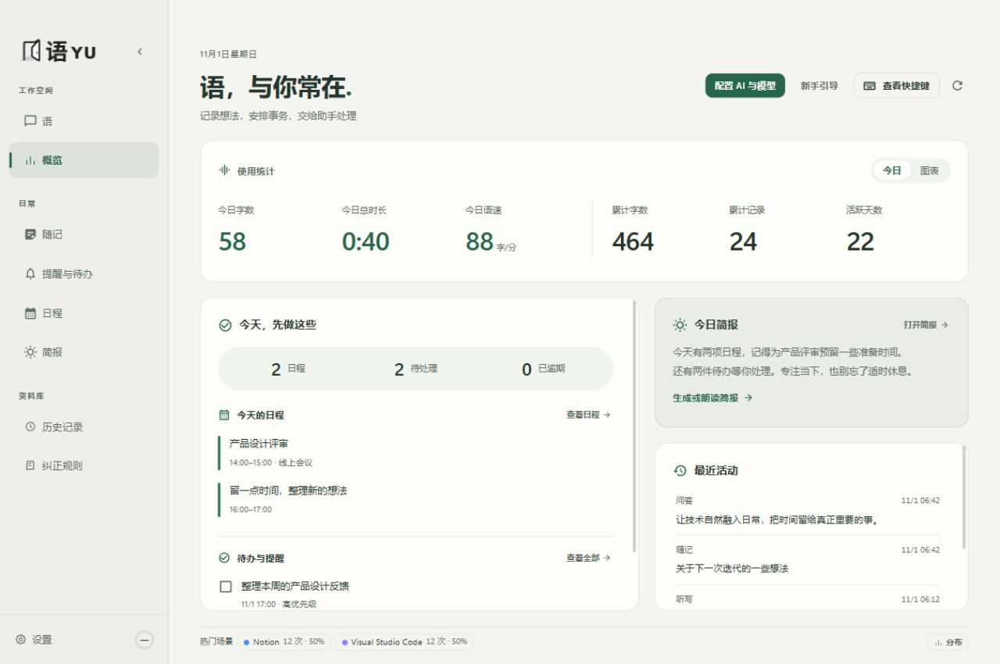
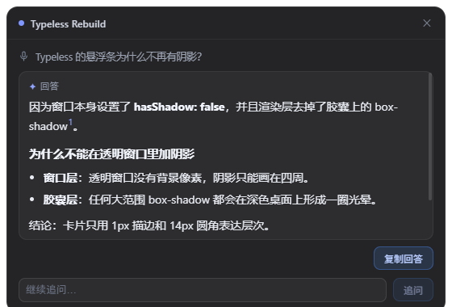

# YU / 语

**Use your own words to work with your computer.**

A Windows voice input and local AI assistant: press a hotkey, speak, and the cleaned-up text is typed into whatever field is focused. The same entry point also translates, answers questions, files notes, creates reminders and replays workflows. Every model is yours to configure, and your data stays on your own machine by default.

Current version **1.2.2-rc.3** · Windows 10/11 x64 · MIT

[中文](README.md) · [Roadmap](ASSISTANT_ROADMAP.md) · [Design philosophy (Chinese)](resources/brand/PHILOSOPHY.zh-CN.md) · [Server deployment](server/README.md)



## What it is

A voice entry point that stays out of the way — not an input method, and not another chat page. Hotkey, audio, recognition, polishing and insertion form one chain. Anything that has to actually happen (set a reminder, schedule an event, file a note, read a page or a local file, run a sequence) goes through whitelisted tools against your real data, and the answer cites where it came from.

Cloud or local is your call: speech recognition, text models and read-aloud can each point at your own accounts or at a service running on this machine. Local recognition works without any cloud model configured.

## What sets it apart

| Difference | What it means |
| --- | --- |
| **One entry point that routes by intent** | No wall of hotkeys: "polish this", "translate it into English", "summarise this page", "remind me in ten minutes", "move the second one to eleven" all enter through the same place, and multi-step requests continue from the previous step's real result |
| **Models are not tied to a subscription** | ASR, LLM and TTS are configured independently and can mix cloud with local; local recognition and OpenAI-compatible endpoints (including a service on this machine) are supported. No platform credits and no per-call middleman |
| **Knowledge base and profile live on this machine** | Cards, the user profile and chats sit in `data\knowledge`, `data\profile` and `data\chat` inside the install directory, maintained as SQLite by the bundled Rust helper. Back them up, move them with the install, or export them on uninstall |
| **The target window is re-checked before writing** | Insertion, selection replacement and appending re-verify the foreground window and the selected text; if either changed, the write is dropped instead of landing somewhere else |
| **Screen capture is a whole chain** | Region select, eight-handle resize, annotations, Windows-local OCR, translation in place, scrolling capture, pinnable images and local QR reading; the image never leaves the machine, and only the recognised text is sent if you configured that |
| **Everything can be self-hosted** | The sync server has zero npm dependencies (Node ≥ 22.5), and `update-feed.txt` can point updates at your own repository. Local features work with no account and no network |
| **It does not sit in your background** | No always-on recording, no clipboard polling, no background screenshots, no window polling; tools are whitelisted and validated, and IPC only accepts the main frame of windows this app created |

## Core capabilities

| Capability | In one line |
| --- | --- |
| **Dictation** | Press to talk, press again to stop; the result is inserted at the caret — clipboard paste first, character injection as fallback, then read back to verify |
| **Ask** | Retrieval plus a tool-calling agent; the answer lands in a floating card you can pin, follow up on by text or voice, or save as a note |
| **Translation** | A dedicated translation mode and selection translation, 1–3 target languages, source language left to the recogniser |
| **Notes** | Voice or typed notes with categories and tags, playback, and audio import with re-transcription; polished text and the raw transcript are kept separately |
| **Reminders / to-dos** | Natural-language times (Chrono plus programmatic checks), repeats, snooze, a strong-alert overlay, missed-item recovery; to-dos can carry a priority and a deadline |
| **Events / briefing** | Month grid, day list, ICS import and export, external calendar subscriptions; the briefing gathers today's events and due items into one paragraph, read aloud on request, with quiet hours |
| **Automation** | Save a sequence of steps as a named workflow — with conditions, fallback branches and references to earlier results — then replay it with one sentence, re-checking permissions at every step |
| **Screen capture** | Region capture, annotations, local OCR, translation in place, scrolling long screenshots, pinned images |
| **Local search** | File bodies in directories you pick (plain text, DOCX, XLSX, PPTX, text-based PDF), optionally through the Everything index; `node_modules`, `.git` and system directories are skipped |
| **Wake word** | An optional offline wake word, recognised locally with an adjustable confidence threshold; nothing before the trigger is uploaded or stored |
| **Sync** | Optional self-hosted server for history, notes and note audio, events and reminders, and per-device stats; without it everything stays local |
| **Updates** | Checks this project's GitHub Releases by default, with segmented downloads and checksum verification, or point it at your own feed — or turn it off |




## Keyboard shortcuts

| Action | Default shortcut |
| --- | --- |
| Dictation (recognise + polish + insert) | Tap `Right Alt` to start, tap again to stop |
| Ask (with retrieval) | `Space + Right Alt` to start, a single `Right Alt` to stop |
| Translation mode | `Right Alt + Right Shift` |
| Paste the last result | `Left Ctrl + Right Shift + V` |
| Polish / translate the selection | `Left Ctrl + Right Shift + S` / `T` |
| Quick voice reminder | `Left Ctrl + Right Shift + R` |
| Region capture / OCR / translate | `Left Ctrl + Right Shift + X` |
| Settings / new note | `Ctrl + ,` / `Ctrl + N` (notes page) |

Every shortcut can be re-recorded or cleared, and the tray menu can suspend all of them. The trigger can be switched to push-to-talk. Pressing `Esc` while recording discards that take: nothing is inserted and nothing is written to history.

## Install and first run

**Install:** download `YU-<version>-setup.exe` from [GitHub Releases](https://github.com/sqslm/YU/releases) and run it. The installer is **unsigned**, so Windows SmartScreen will warn and you have to confirm manually.

**First run, three steps:**

1. Open *Settings → Models & intelligence* and add a speech-recognition (ASR) and a text-model (LLM) connection: address, key, model, then test the connection.
2. Tap `Right Alt`, say a sentence, and release when the recording strip shows text.
3. Optional: sign in to your own server for sync, learn a wake word under *Voice & input → Wake word*, remap shortcuts under *Shortcuts*.

No API key yet? `pnpm mock` starts a fake OpenAI-compatible backend at `http://127.0.0.1:8787/v1` so you can try the whole chain.

## Build from source

You need Windows 10/11 x64, Node.js 22.18+, pnpm 11, plus a Rust stable MSVC toolchain and Visual Studio C++ Build Tools / Windows SDK. Rust is build-time only; end users do not need it.

```powershell
git clone https://github.com/sqslm/YU.git
cd YU
pnpm install --frozen-lockfile
pnpm build
Remove-Item Env:ELECTRON_RUN_AS_NODE -ErrorAction SilentlyContinue
node_modules\electron\dist\electron.exe .
```

`pnpm dev` runs the development build; `pnpm package` builds the installer into `release\` (unsigned). Test and acceptance commands are listed in `package.json` and the [roadmap](ASSISTANT_ROADMAP.md).

## Data and privacy

- Settings, history, notes, events and reminders live in the app folder under `%APPDATA%`; the knowledge base, profile and chats live in `data\` inside the install directory, which therefore has to be writable.
- Keys are encrypted with Windows secure storage (DPAPI); the settings file only holds ciphertext.
- Screen, selection and clipboard are read only on an explicit action, and the original window is re-checked before and after; password managers are refused.
- Assistant tools are whitelisted and parameter-checked: irreversible deletion, arbitrary commands, software installs and system changes are refused; opening a page requires a URL that came from real retrieval.
- Diagnostics export redacts credentials, URLs, e-mail addresses, intranet addresses and local paths.
- A backup is a folder with a `manifest.json` covering chats and attachments, notes and audio, history, reminders, events, workflows, entities, the memory store, the knowledge and profile databases and settings. Restores are verified before anything is replaced, and the previous files stay in `.yu-before-restore-*`.

## Self-hosting and updates

- **Sync:** deploy `server/` (zero npm dependencies, Node ≥ 22.5) and enter your own address under *Settings → Account* to sync across devices. The server handles accounts and sync only — models are still configured per client, and notes are stored in plain text server-side, readable by the administrator.
- **Updates:** the default feed is this project's GitHub Releases. Use `update-feed.txt` or an environment variable to point it at your own address, or turn automatic checks off entirely.

## Documentation

| Document | What is inside |
| --- | --- |
| [ASSISTANT_ROADMAP.md](ASSISTANT_ROADMAP.md) | Capability list for the unified entry point, current architecture, item-by-item status and measurements |
| [docs/](docs/) | Design plans, staged acceptance records, native module notes |
| [server/README.md](server/README.md) | Deploying the self-hosted sync server, including Docker |
| [THIRD_PARTY_NOTICES.md](THIRD_PARTY_NOTICES.md) | Third-party dependencies and licences |
| [resources/brand/PHILOSOPHY.zh-CN.md](resources/brand/PHILOSOPHY.zh-CN.md) | Design philosophy and interface trade-offs (Chinese) |

## License

MIT, see [LICENSE](LICENSE). Third-party dependencies keep their own licences; speech model weights are not distributed with the installer or the source, and follow each model's licence once downloaded.
