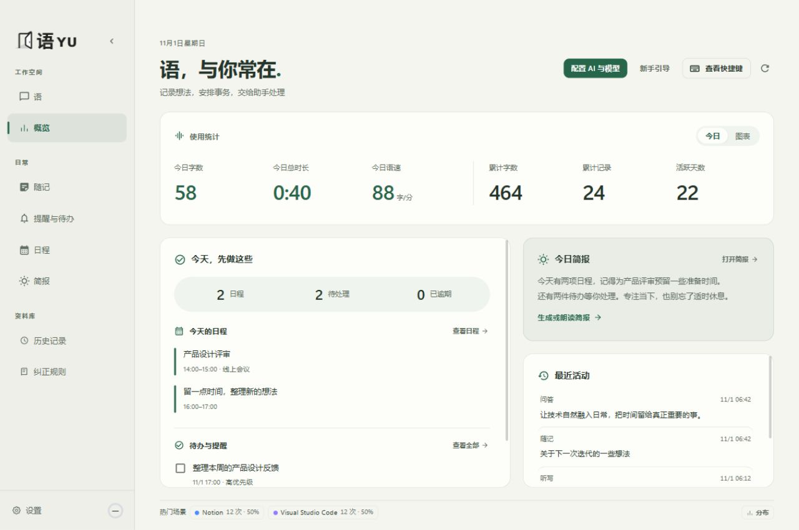
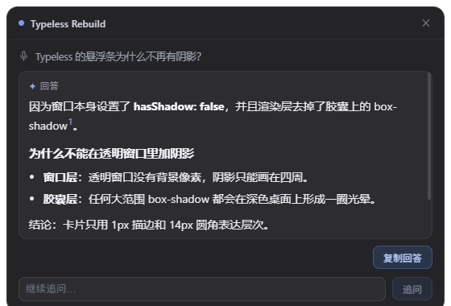

# 语 / YU

**用你的方式，与电脑交流。**

Windows 上的语音输入与本地 AI 助手：按一下热键说话，松手后自动「识别 → 润色 → 整段插入」到你正在打字的任何位置。同一个入口还能翻译、提问、记随记、建提醒、跑工作流。模型由你自己配置，数据默认只留在本机。

当前版本 **1.2.2-rc.3** · Windows 10/11 x64 · MIT

[English](README.en.md) · [路线图](ASSISTANT_ROADMAP.md) · [设计理念](resources/brand/PHILOSOPHY.zh-CN.md) · [服务端部署](server/README.md)



## 它是什么

一个常驻的语音入口，不是输入法，也不是聊天网页。热键、录音、识别、润色、插入是一条链；需要真正落地的事情（设提醒、排日程、记随记、读网页或本地文件、跑一串步骤）都交给白名单工具，用真实数据执行，结果带来源。

云端还是本机，由你选：语音识别、文本模型、朗读都可以指向自己的账号或本机服务；不配置云端也能用本地识别。

## 和同类软件不一样的地方

| 差异 | 说明 |
| --- | --- |
| **一个入口按意图分流** | 不用记一屏热键：说「润色这段」「翻译成英文」「总结这个网页」「十分钟后提醒我喝水」「把第二条改到十一点」，同一个入口按内容分流到对应能力，复合任务按前一步的真实结果继续 |
| **模型不被订阅绑死** | ASR / LLM / TTS 各自独立配置，可混用云端与本地；支持本地识别与 OpenAI 兼容端点（含本机服务）。没有平台代币，也没有按次计费的中转 |
| **知识库与画像在本机** | 知识卡片、用户画像、聊天分别落在安装目录的 `data\knowledge`、`data\profile`、`data\chat`，由随包的 Rust 助手维护 SQLite；可备份、可整体迁移，卸载时可以导出带走 |
| **写回前先核对原窗口** | 插入、覆盖选区、追加结果之前复核前台窗口与选中文字；窗口换了、文本变了就放弃这次写入，不把结果盖到别处 |
| **截图是完整链路** | 框选、八节点缩放、标注、Windows 本地 OCR、原位翻译、滚动长截图、可置顶贴图、本地扫码；图片不离开本机，只有你确认后才按配置发送识别文字 |
| **可以完全自建** | 同步服务端零 npm 依赖（Node ≥ 22.5），也可以用 `update-feed.txt` 把更新源指到自己的仓库；不登录、不联网也能用全部本地功能 |
| **默认不碰你的后台** | 不常驻录音、不后台监听剪贴板、不后台截图、不轮询窗口；工具调用走白名单 + 参数校验，IPC 只接受本应用自己窗口的主框架调用 |

## 核心功能

| 能力 | 说明 |
| --- | --- |
| **听写** | 按一下说话、再按一下结束，结果插入光标处；默认剪贴板整段粘贴，失败回退逐字符输入，并回读校验 |
| **Ask** | 联网检索 + 工具 Agent，答案进独立回答卡：可固定、可文字或语音追问、可存成随记 |
| **翻译** | 独立翻译模式与选区翻译，目标语言可配 1–3 个，识别语言交给 ASR 自动判断 |
| **随记** | 语音或文字记录、分类与标签、录音回放、导入音频重转写；润色稿与原始转写分开保存 |
| **提醒 / 待办** | 中文自然语言时间（Chrono + 程序校验）、重复规则、稍后提醒、强提醒遮罩、错过补报；待办可带优先级与截止时间 |
| **日程 / 简报** | 月历 + 当天清单 + ICS 导入导出 + 外部日历订阅；简报把当天安排与到期待办整理成一段话，可朗读、有免打扰时段 |
| **自动化** | 把一串步骤存成命名工作流，支持条件与备用分支、引用前序真实结果；之后一句话重放，每步重新检查权限 |
| **截图** | 框选截图、标注、本地 OCR 取字、原位翻译、滚动长截图、贴图 |
| **本地检索** | 检索你指定目录里的文件正文（纯文本 / DOCX / XLSX / PPTX / 文本型 PDF），也可借助 Everything 索引；跳过 `node_modules`、`.git` 与系统目录 |
| **唤醒** | 可选的离线唤醒词，本地识别、可调置信度；唤醒前的音频不上传、不保存 |
| **同步** | 可选自建服务端：听写历史、随记与录音、日程与提醒、按设备的统计；不登录就完全本地 |
| **更新** | 默认从本项目的 GitHub Releases 检查；分段下载、校验后重启安装，可换成自己的更新源或关掉 |




## 快捷键

| 操作 | 默认快捷键 |
| --- | --- |
| 听写（识别 + 润色 + 插入） | `右 Alt` 按一下开始，再按一下结束 |
| Ask（可联网检索后回答） | `Space + 右 Alt` 起，单按 `右 Alt` 结束 |
| 翻译模式 | `右 Alt + 右 Shift` |
| 粘贴上一条结果 | `左 Ctrl + 右 Shift + V` |
| 选区润色 / 选区翻译 | `左 Ctrl + 右 Shift + S` / `T` |
| 快速语音提醒 | `左 Ctrl + 右 Shift + R` |
| 框选截图 / OCR / 翻译 | `左 Ctrl + 右 Shift + X` |
| 设置 / 新建随记 | `Ctrl + ,` / `Ctrl + N`（随记页） |

全部可改绑、可清空，托盘菜单能临时停用；触发方式可切成「按住说话」。录音中按 `Esc` 直接丢弃这一条：不插入、不写历史。

## 安装与首次配置

**直接安装**：从 [GitHub Releases](https://github.com/sqslm/YU/releases) 下载 `YU-<版本>-setup.exe` 运行。安装包未签名，Windows SmartScreen 会提示，需要手动确认。

**首次配置**三步：

1. 打开「设置 → 模型与智能」，添加语音识别（ASR）与文本模型（LLM）连接：填地址、密钥、模型，测试连接。
2. 按一下 `右 Alt` 说一句话，看到悬浮条出字即可松手。
3. 可选：登录自建服务端做同步、在「语音与输入 → 语音唤醒」学习唤醒词、在「快捷键」页改绑。

没有 API Key 也能先跑起来：`pnpm mock` 会在 `http://127.0.0.1:8787/v1` 起一个假后端供自测。

## 从源码构建

需要 Windows 10/11 x64、Node.js 22.18+、pnpm 11，以及 Rust stable MSVC 工具链与 Visual Studio C++ Build Tools / Windows SDK。Rust 只用于构建，最终用户无需安装。

```powershell
git clone https://github.com/sqslm/YU.git
cd YU
pnpm install --frozen-lockfile
pnpm build
Remove-Item Env:ELECTRON_RUN_AS_NODE -ErrorAction SilentlyContinue
node_modules\electron\dist\electron.exe .
```

开发模式用 `pnpm dev`；打包安装器用 `pnpm package`（产物在 `release\`，未签名）。测试与验收命令见 `package.json` 与 [路线图](ASSISTANT_ROADMAP.md)。

## 数据与隐私

- 配置、历史、随记、日程、提醒在 `%APPDATA%` 下的应用目录；知识库、画像、聊天在安装目录的 `data\` 下，安装目录必须可写。
- 密钥用 Windows 系统安全存储（DPAPI）加密，配置文件里只留密文。
- 只有明确触发的操作才读屏幕、选区与剪贴板；读取前后复核原窗口，密码类应用拒绝自动读取。
- 助手的本地工具是白名单 + 参数校验：不可逆删除、任意命令、软件安装、系统修改直接拒绝；打开网页要求地址来自真实检索结果。
- 导出诊断会遮蔽凭据、网址、邮箱、内网地址和本机路径。
- 备份是带 `manifest.json` 的目录，含聊天与附件、随记与录音、历史、提醒、日程、工作流、实体词、记忆库、知识库与画像和设置；恢复前先校验再替换，旧文件保留在 `.yu-before-restore-*`。

## 自建与扩展

- **同步**：部署 `server/`（零 npm 依赖，Node ≥ 22.5），在「设置 → 账户」填自己的地址即可跨设备同步。服务端只做账号与同步，模型仍由客户端各自配置；随记在服务端是明文存储、管理员可读。
- **更新源**：默认走本项目的 GitHub Releases，可用 `update-feed.txt` 或环境变量改成自己的地址，也可以完全关掉自动检查。

## 文档

| 文档 | 内容 |
| --- | --- |
| [ASSISTANT_ROADMAP.md](ASSISTANT_ROADMAP.md) | 统一入口功能清单、现行架构、逐项状态与测量结果 |
| [docs/](docs/) | 设计计划、分阶段验收记录、原生模块说明 |
| [server/README.md](server/README.md) | 自建同步服务端的部署与 Docker 用法 |
| [THIRD_PARTY_NOTICES.md](THIRD_PARTY_NOTICES.md) | 第三方依赖与许可 |
| [resources/brand/PHILOSOPHY.zh-CN.md](resources/brand/PHILOSOPHY.zh-CN.md) | 设计理念与界面取舍 |

## 许可

MIT，见 [LICENSE](LICENSE)。第三方依赖保留各自许可；语音模型权重不随安装器和源码分发，下载后遵循各模型自己的许可。
